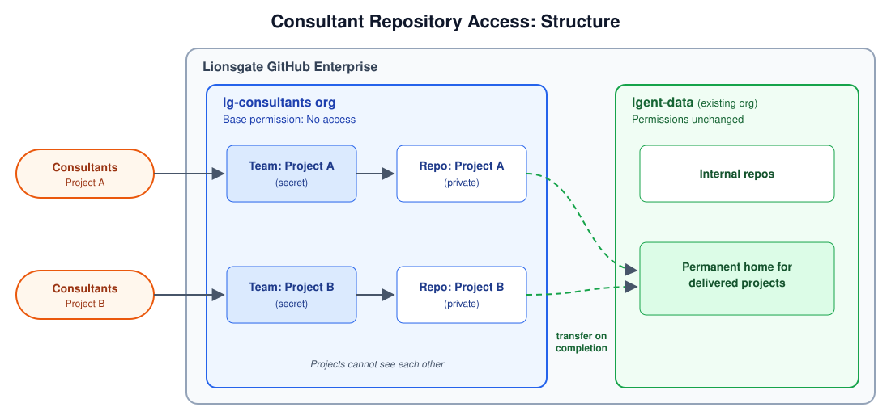
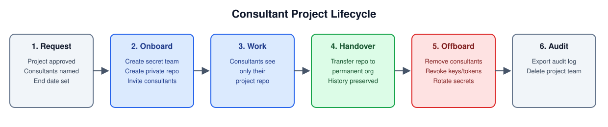

# Consultant Repository Access: `lg-consultants` Org

## Why
Consultants and project-based resources need access to **only the repo they work on**, without changing permissions in our existing GitHub orgs. A dedicated `lg-consultants` org isolates their access and makes offboarding clean.

## Structure

## Lifecycle

## Controls

| Risk | Control |
|---|---|
| Consultants see other Lionsgate code | Separate org; existing orgs untouched |
| Consultants see other consultant projects | Base permission "No access"; one secret team per project |
| Code copied out through forks or new repos | Private forking and repo creation disabled |
| Access lingers after project ends | Offboarding checklist; end date tracked on each team |
| Shared credentials exposed | Per-consultant credentials; secrets rotated at roll-off |
| Loss of work at roll-off | Repo transfer keeps commits, issues, PRs, and releases |

## Roles
- **Org owners:** project lead + one backup (no consultants)
- **Consultants:** org members, write access to their project repo only
- **Receiving org owner:** accepts the transferred repo and grants internal team access
